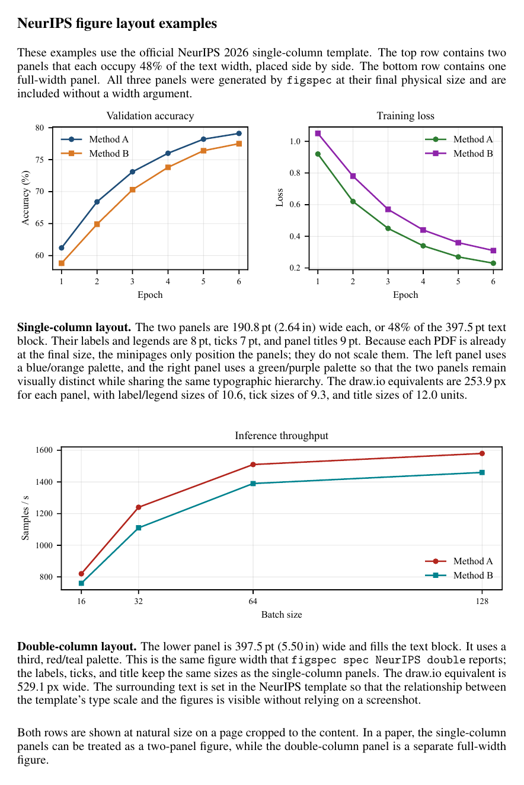

# paper-figure-skills

为学术论文绘图确定画布宽度、字号与字体，并提供 matplotlib 配置、成品图检查、LaTeX 预览和 draw.io 校准。

支持 venue：CVPR、ICCV、NeurIPS、ICLR、ICML、ACL、AAAI、ACM MM、CCS、S&P、USENIX Security、NDSS、TIFS、TPAMI、IJCV、TMM。

## 示例

一页展示三个 NeurIPS 图像：两个 single 子图并排（各占 48% 文本宽度），一个 double 图像占满文本宽度；三张图使用不同配色，页面裁切到内容。

[打开 PDF](examples/showcase-neurips.pdf)



源文件：`examples/showcase-neurips.tex`。三张图由 `examples/make_showcase_figures.py` 生成。

## 安装

要求：macOS + MacTeX；Python 3.10+；`pdffonts`（poppler）在 `PATH` 中。

```bash
git clone <repo-url> paper-figure-skills
cd paper-figure-skills

# 安装 skill：默认使用符号链接，git pull 后自动更新
./install.sh

# 在目标 Python 环境中安装包（与运行 figspec 的环境相同）
pip install -e .

# 安装 Linux Libertine / Latin Modern 并检查三种字体
figspec fonts --install
figspec fonts --check
```

安装脚本默认同时安装到：

- `~/.config/opencode/skills/paper-figure-spec`
- `~/.codex/skills/paper-figure-spec`

也支持：

```bash
./install.sh --only opencode     # 只装 OpenCode
./install.sh --only codex        # 只装 Codex
./install.sh --copy              # 复制而不是符号链接
```

**是否需要 `--copy`**：在 macOS / OpenCode 2.0.29 上验证，默认符号链接安装即可被新会话发现，**不需要 `--copy`**。如果某个客户端不跟随目录符号链接，改用 `./install.sh --copy` 后重启客户端。

安装后重启 OpenCode/Codex。新会话应能列出 `paper-figure-spec` skill。

## 使用

```bash
figspec spec CVPR single
figspec spec NeurIPS double
figspec fonts --check
figspec probe --all
figspec probe --tex /path/to/paper/main.tex --venue CVPR
figspec check fig.pdf CVPR single
figspec preview CVPR single fig.pdf
figspec calib                 # 生成 draw.io 校准文件
figspec calib --measure       # 测量 calib/out.pdf 后更新 draw.io 字段
```

绘图代码：

```python
import figspec

spec = figspec.setup("CVPR", "single")
fig, ax = plt.subplots(
    figsize=(spec.width_in, 2.2),
    layout="constrained",
)
ax.plot(x, y, label="method")
ax.legend()
fig.savefig("fig.pdf")
```

说明：

- `figspec spec` 输出目标宽度、字号、字体和 draw.io 等效值。
- `figspec.setup()` 会设置字体、字号、mathtext 和 PDF/SVG 字体嵌入参数；返回的 spec 包含 `width_in`、`width_pt` 和各级字号。
- 每张成品图都应运行 `figspec check`；FAIL 时修正后重新导出。
- `figspec preview` 会用官方模板编译，成功后自动打开 PDF。
- `figspec probe --tex` 的结果写入论文目录的 `.figspec.yaml`，之后 `spec`/`setup` 优先使用它。
- 在 draw.io 中修改时另存 SVG；导入 SVG 的缩放补偿和字号换算见 `skills/paper-figure-spec/references/drawio.md`。

LaTeX 中按最终尺寸插入，不指定宽度：

```tex
\includegraphics{fig.pdf}
```

## 示例与测试

```bash
python examples/make_examples.py   # 重新生成 8 张示例图
pytest -q                          # specs、aliases、check 自测
```

示例 PDF 位于 `examples/`。

## 每年更新模板

```bash
# 1. 用官方最新模板替换 templates/<venue>/
# 2. 重新探测
figspec probe <venue>
# 3. 检查 venues.yaml 的 diff 是否只包含预期的数值变化
git diff -- figspec/data/venues.yaml
# 4. 提交
git add -A && git commit -m "update <venue> template"
```

不要手改 `figspec/data/venues.yaml`；数值只能由 `figspec probe`（以及 `figspec calib --measure`）生成。若模板的宽度/字号发生明显变化，已安装的 skill 通过 `git pull` 自动获得新的 `venues.yaml`。
